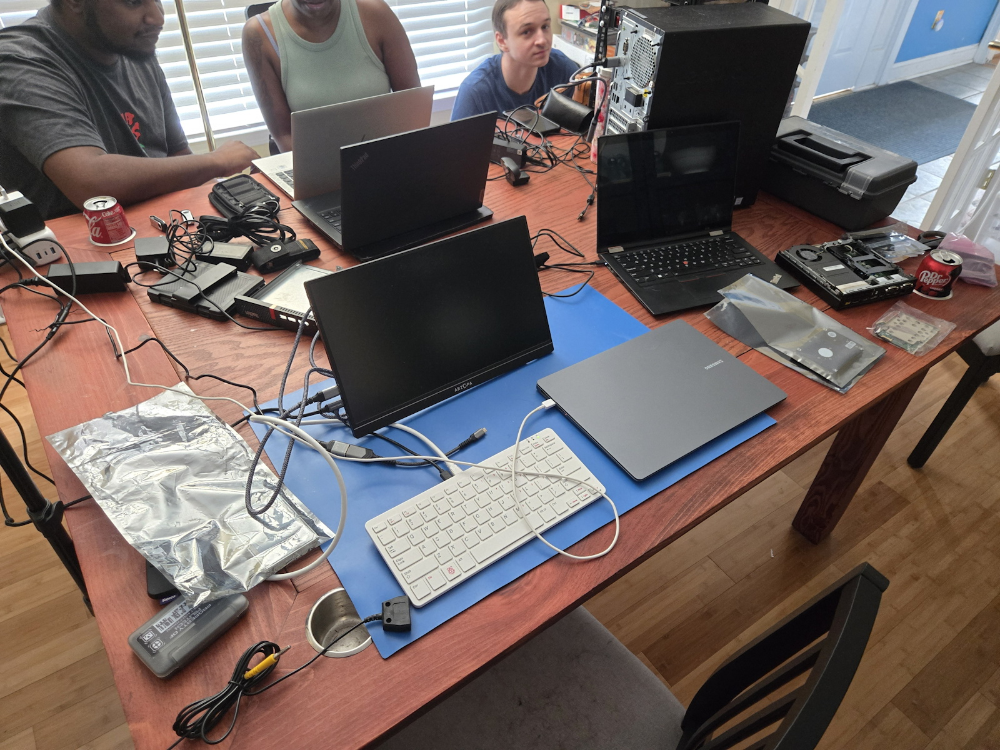
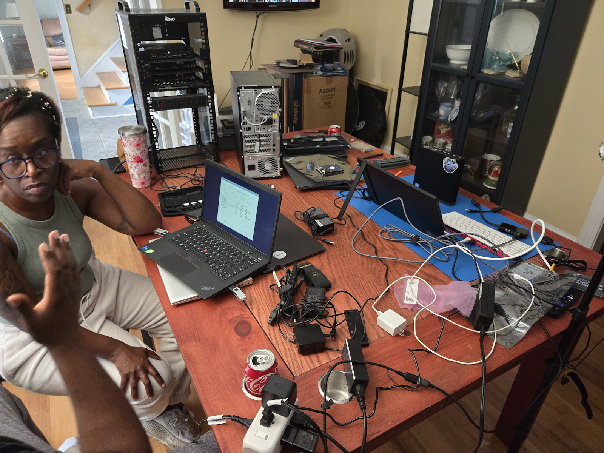
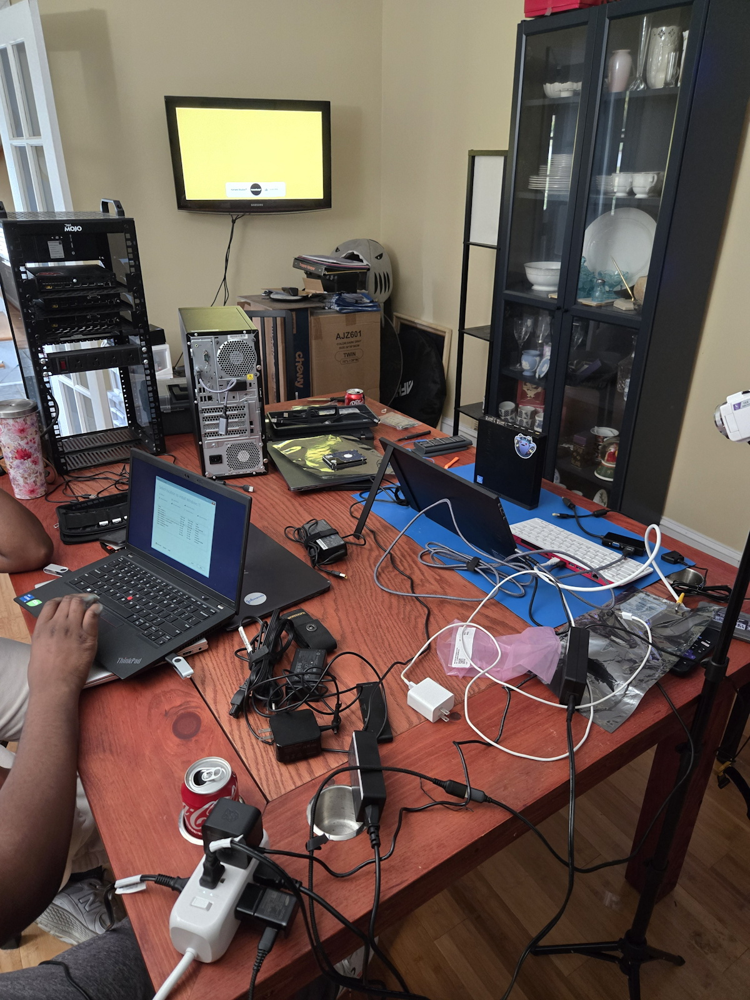
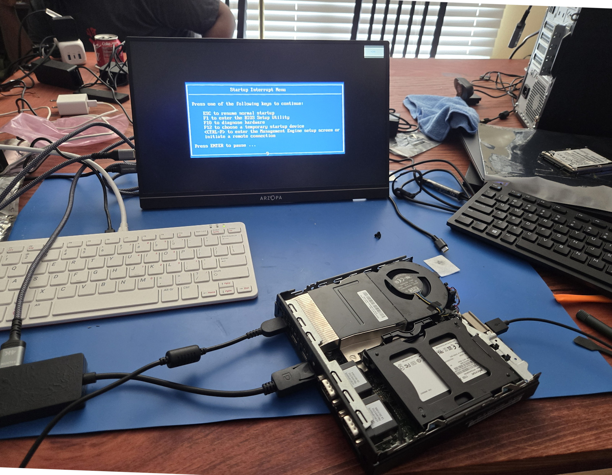
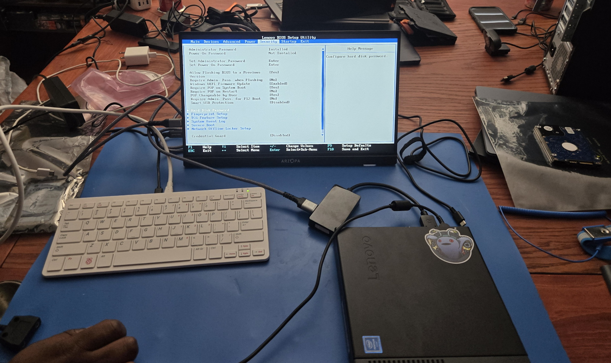
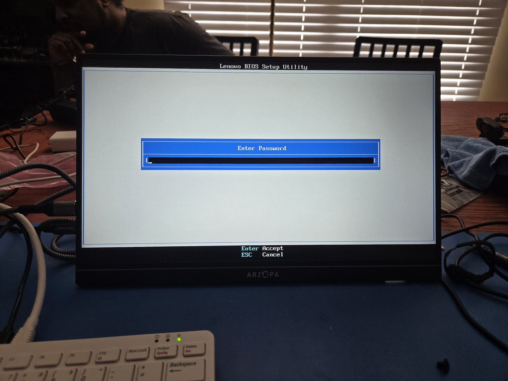
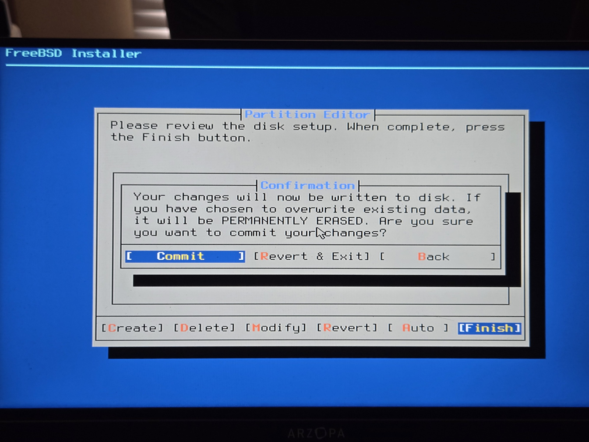
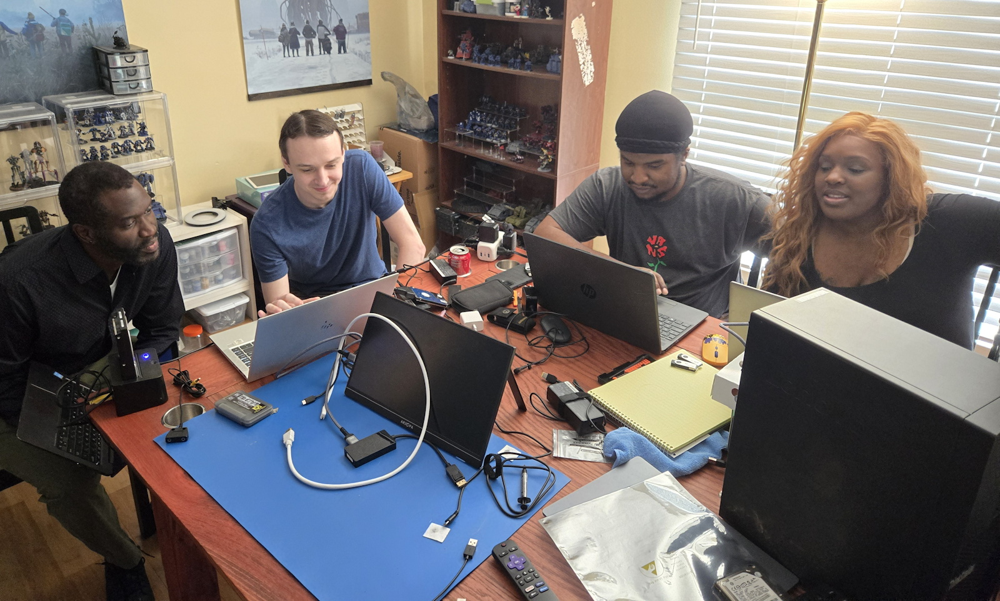
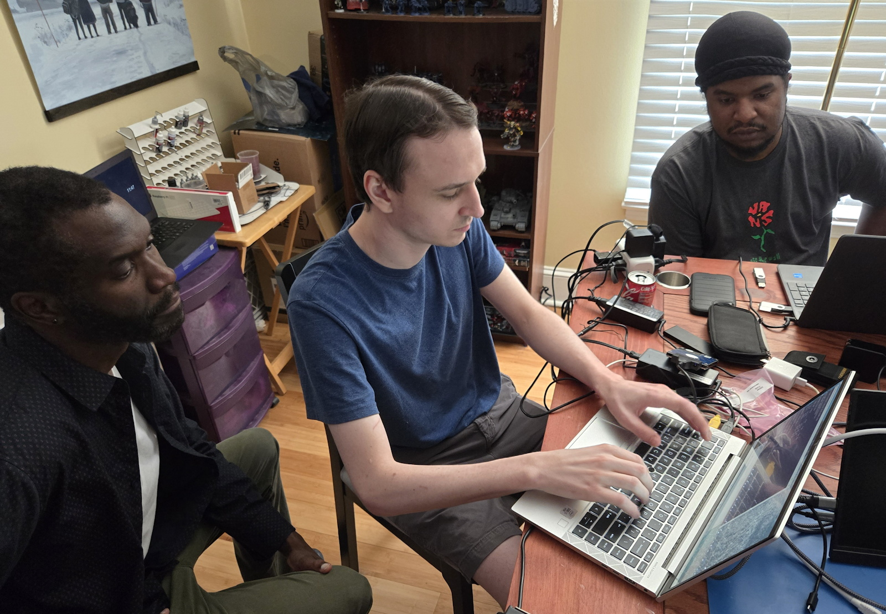
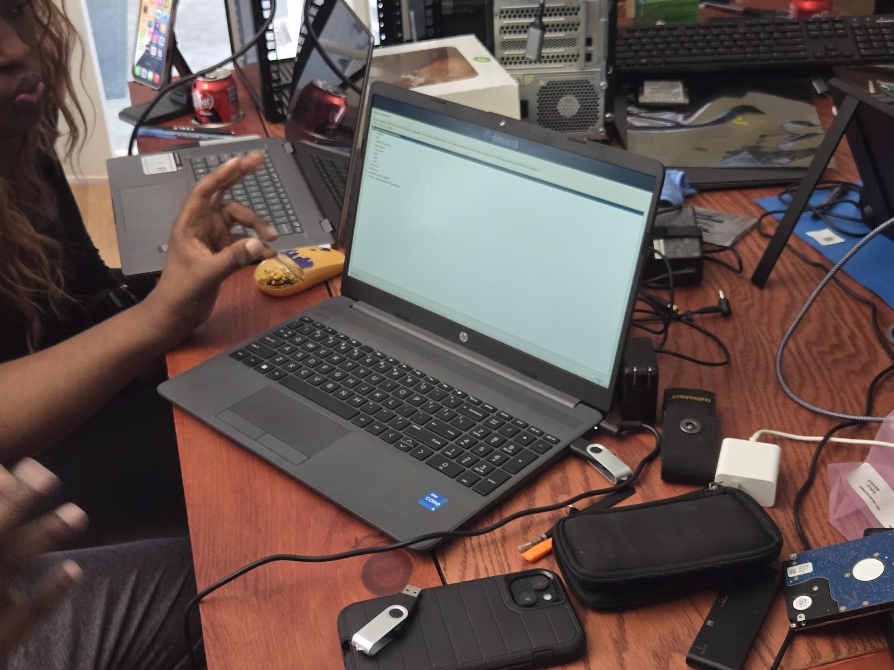

# 10/03/2026: OS Installs and BIOS Work

Team lab day. We set up the lab space, worked in the BIOS on the Lenovo tiny PCs, and ran a FreeBSD install. 

## Lab crew
- Brian Ayiteyfio

- Darius Phillips

- Eric Rion

- Mary Harbin

- Matthew Murray

- Shannon Jordan

## What we did

- Set up a shared workspace with ESD mats, monitors, keyboards and the machines we were working on.

- Opened up a Lenovo tiny PC and used the startup interrupt menu to get into the BIOS and boot options.

- Hit a BIOS password prompt on one machine. 

- Installed FreeBSD and used its partition editor to wipe and repartition the target drive.

## Troubleshooting

| Problem | Cause | Fix |
| --- | --- | --- |
| BIOS asked for a password | Old owner used a password and didn't give it to me when I purchased the unit | This was a tough one. I tried removing the CMOS battery but that didn't work. Eventually I had to locate the BIOS jumper and remove it. |

## Lessons learned

- It seems like  fewer and fewer computers can bypass the BIOS password issue just by removing the BIOS.

## Photos

<table>

<tr>

<td> Lab space</td>

<td> Lab space</td>

<td> Lab space</td>

</tr>

<tr>

<td> Startup interrupt menu on a tiny PC</td>

<td> Lenovo BIOS setup</td>

<td> BIOS password prompt</td>

</tr>

<tr>

<td> FreeBSD partition editor</td>

<td> Team projects</td>

<td> Team projects</td>

</tr>

<tr>

<td> Laptop Diagnostics</td>

</tr>

</table>

