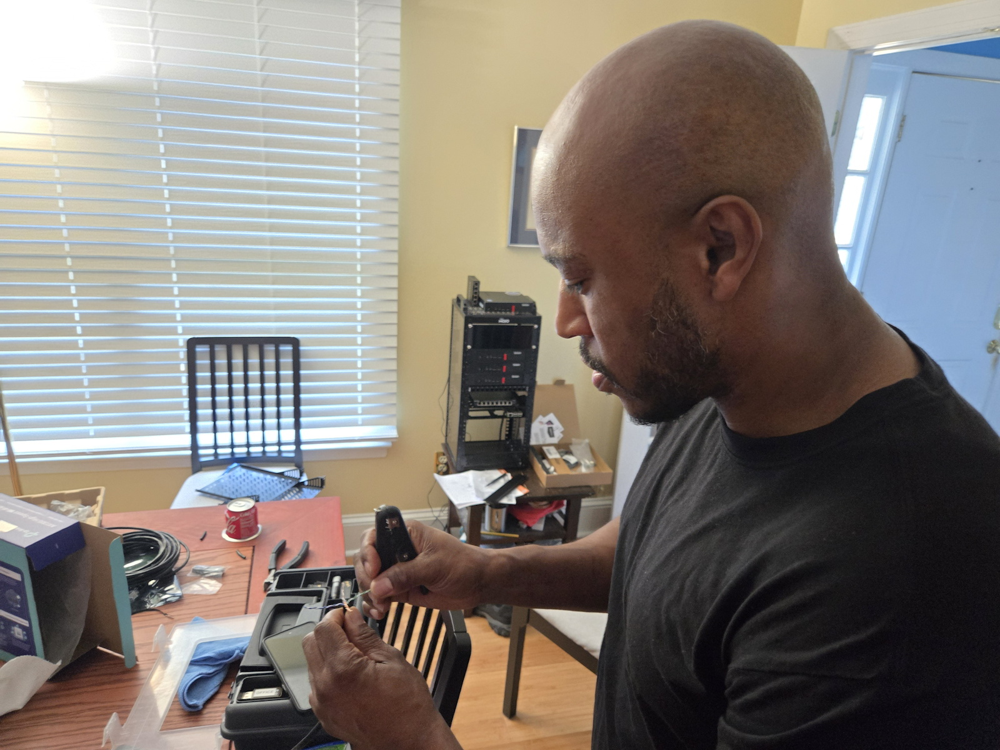
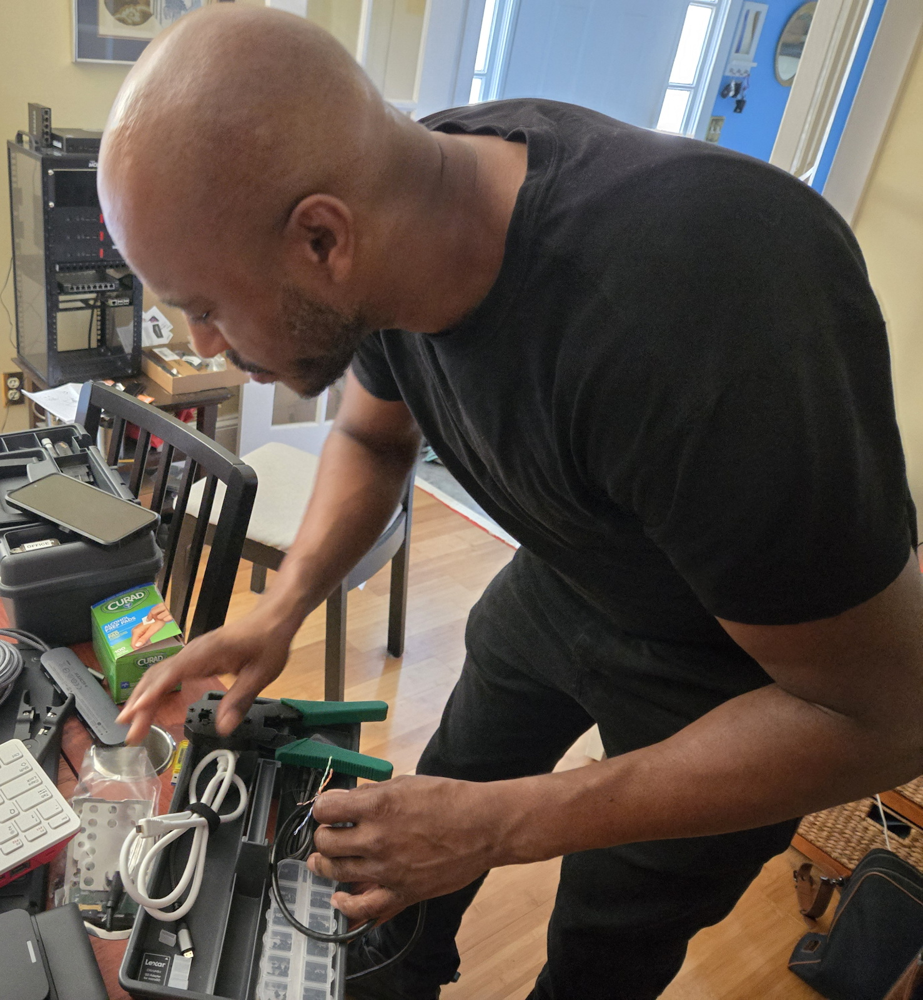
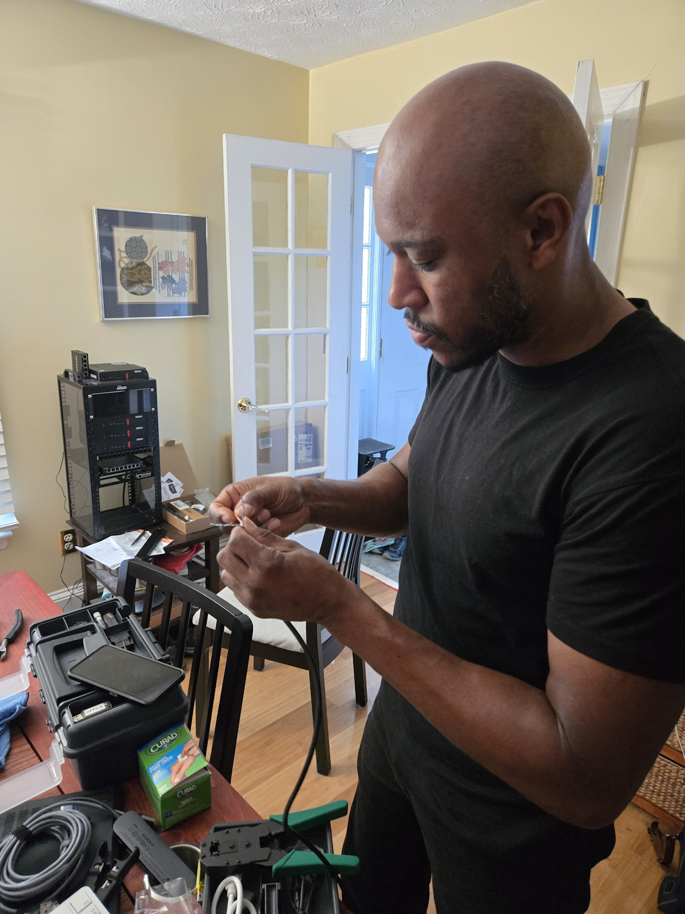
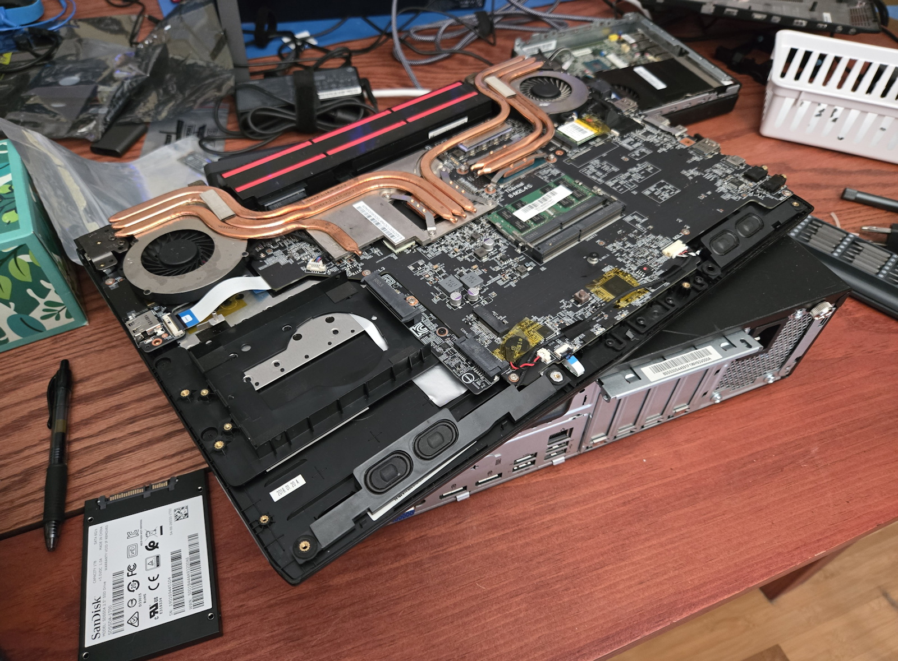

# 10/10/2026: Cable Termination and Laptop Teardown

Team lab day. We practiced terminating Cat6 cables with RJ45 connectors and took apart an old gaming laptop. 

## Lab crew

* Eric Rion
* O'Donald Freeman

## What we did

- O'Donald terminated Cat6 cables: stripped the jacket, put the wires in T568B order, and crimped on RJ45 connectors.

- Took apart a gaming laptop down to the motherboard and pulled the SATA SSD.

## Lessons learned

- T568B order: orange-white, orange, green-white, blue, blue-white, green, brown-white, brown.

## Photos

<table>

<tr>

<td> O'Donald terminating Cat6</td>

<td> Crimping an RJ45 connector</td>

<td> Checking the finished end</td>

</tr>

<tr>

<td> Gaming laptop teardown</td>

</tr>

</table>

