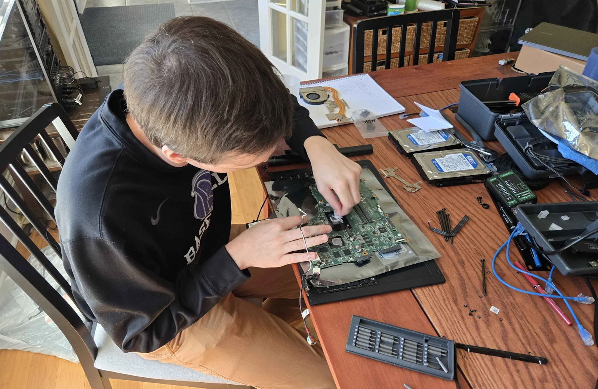
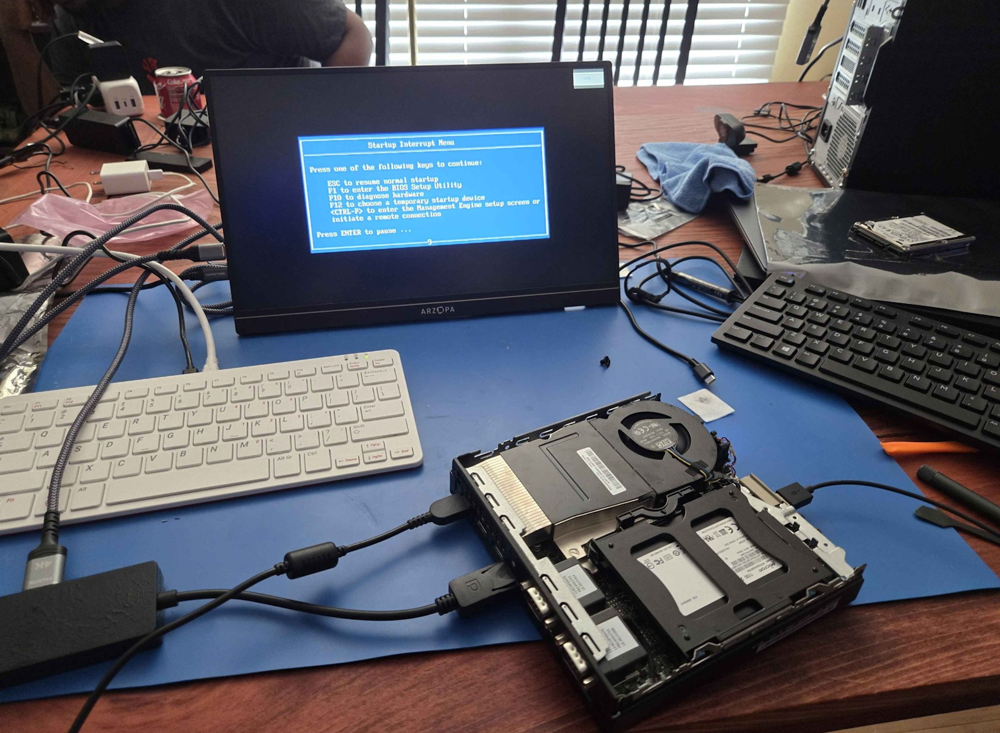
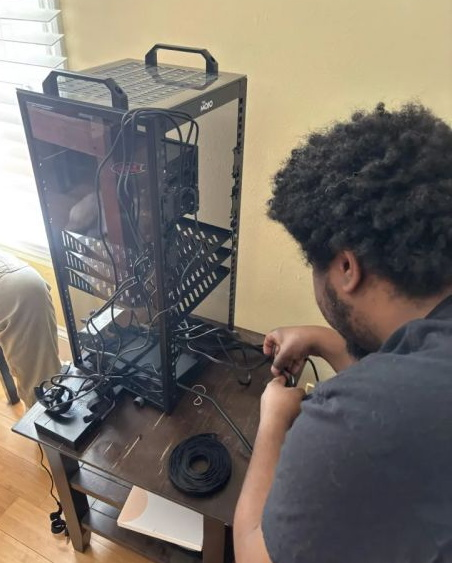
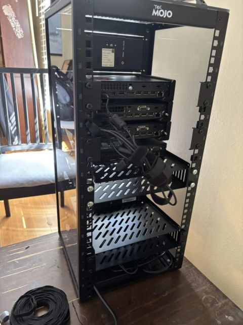

# 10/24/2026: Drive Triage, Wiping and NAS Bring-Up

Team lab day. We tested and labeled a batch of used drives, planned how to wipe them, tried to bring up the ix4-300d NAS, and took apart an old laptop for parts.

## Drive results

Each drive got a three-digit ID and a Sharpie color: green = good, orange = caution, red = bad. Health was checked with CrystalDiskInfo.

| Drive | Result | Plan |
| --- | --- | --- |
| 2.5" "Colonel Clink" | Clicking, failed | Retire |
| 2.5" drive | Caution, reallocated sectors rising | Jack Frost, kept to watch it fail on purpose |
| 3.5" drives (all) | Good | NAS RAID 5 |
| High-hours drive | \~104,000 power-on hours (\~11.9 yrs) | Use, but monitor |

## Troubleshooting

| Problem | Cause | Fix |
| --- | --- | --- |
| CrystalDiskInfo didn't see a hot-swapped drive | Refresh doesn't detect new drives | Use Rescan instead |
| NAS reported all drives missing | LenovoEMC firmware ignores drives that already have partitions | Run `diskpart` → `clean` on each drive first |

## Lessons learned

- Zero-wiping a 500 GB HDD takes 1.5–2 hours, so run wipes on several machines at once.

- A zero overwrite is enough for HDDs. Save Secure Erase for SSDs and NVMe.

- `clean` only removes partitions. `clean all` writes zeros to the whole drive.

- The ix4-300d is ARM-based and can't run TrueNAS. Moving to TrueNAS means putting the drives in an x86 machine.

- The ix4-300d isn't hot-swap. Power it off before changing drives.

- Pull ribbon cable tabs gently. A snapped connector can't be fixed.

## Next steps

- ☑️ Zero-wipe all 3.5" drives

- ☑️ `diskpart clean` the NAS drives, then retest the ix4-300d

- ☑️ Find LenovoEMC Storage Manager for the ix4-300d

- ⬛ Install `smbclient` and `cifs-utils` on Ubuntu to reach the NAS and Windows shares

- ⬛ Get a micro-HDMI dummy plug for headless Pi use

- ⬛ Try HDD Guru tools on Windows

- ⬛ Find the cause of the 23 GB of unexplained usage on one drive

- ⬛ Choose a power-button setup for the laptop-to-desktop build

## Photos

