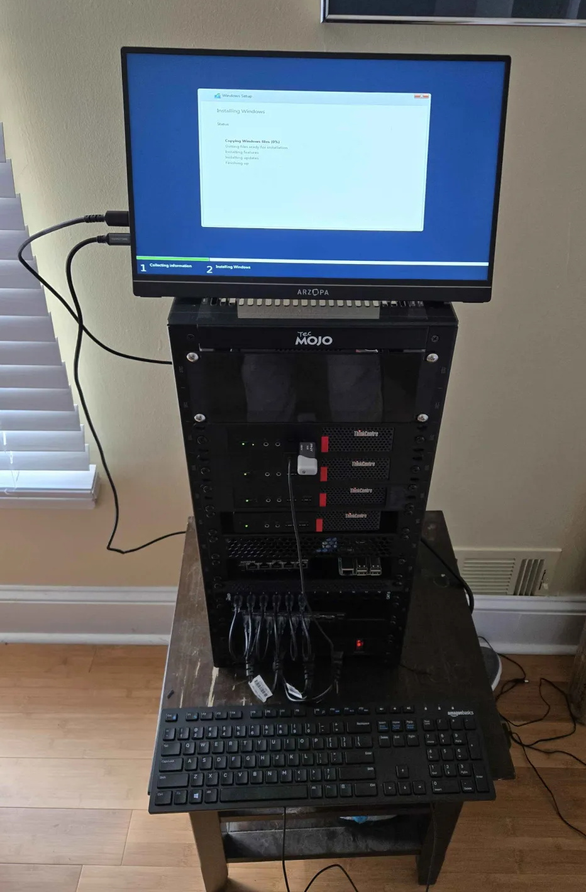
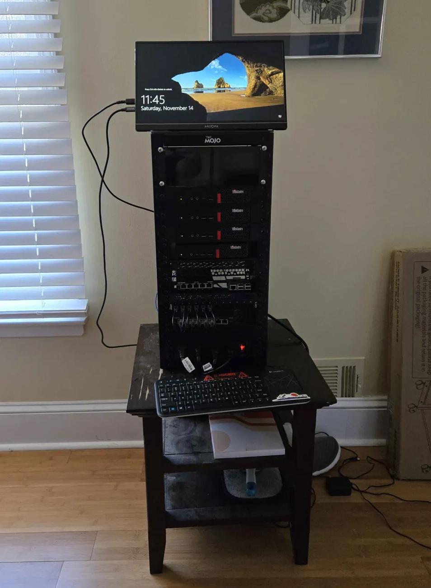
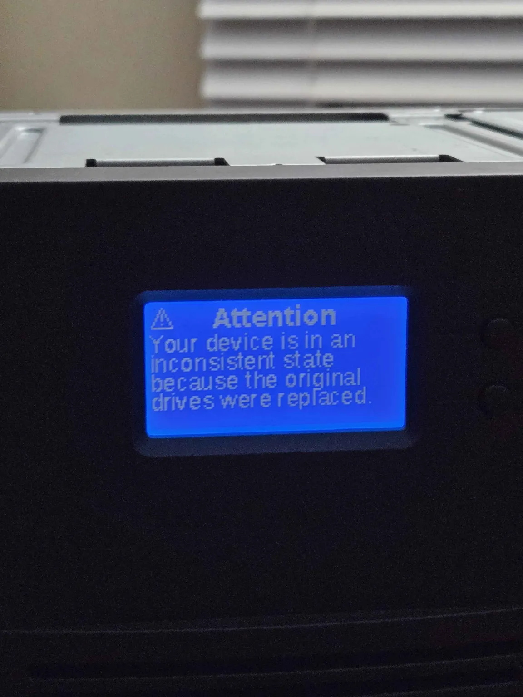
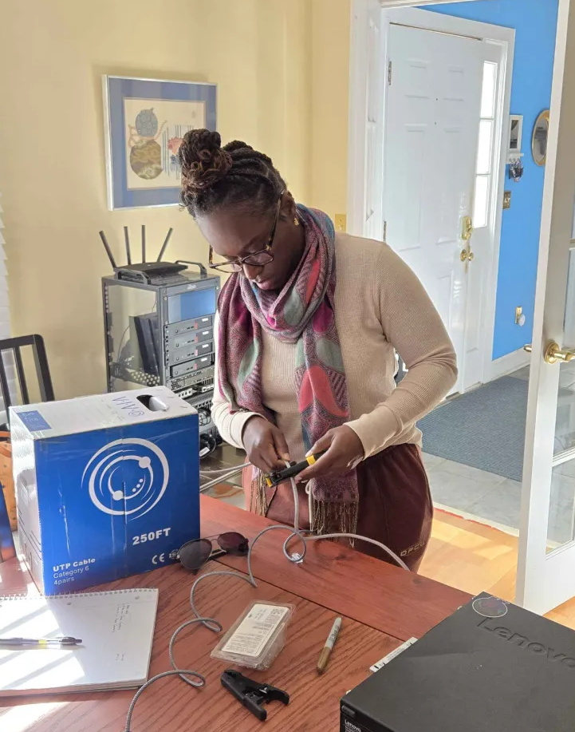
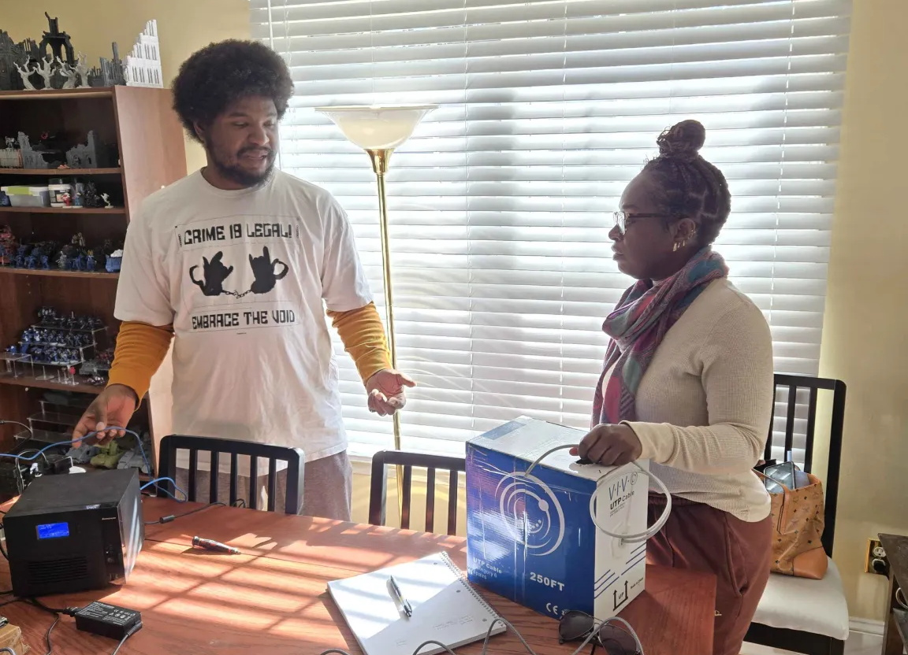

# 11/14/2026: Windows Server Install and NAS Drive Swap

Team lab day. We installed Windows Server 2019 on Decarabia, put new drives in the ix4-300d NAS, and terminated more Cat6. 

## Lab crew

* Darius Phillips
* Eric Rion
* Mary Harbin

## What we did

- Installed Windows Server 2019 on Decarabia from USB, using the rack's touch display, and got it to the login screen.

- Put cleaned drives in the Lenovo ix4-300d NAS. It reported: "Your device is in an inconsistent state because the original drives were replaced."

- Mary terminated Cat6 from a 250 ft spool of UTP cable.

## Troubleshooting

| Problem | Cause | Fix |
| --- | --- | --- |
| NAS said it was in an "inconsistent state" | The original drives were replaced with new ones | Re-mapped new drives into NAS |

## Lessons learned

- TBD

## Photos

<table>

<tr>

<td> Installing Windows Server 2019</td>

<td> Windows Server up and running</td>

<td> NAS after the drive swap</td>

</tr>

<tr>

<td> Mary terminating Cat6</td>

<td> Darius and Mary</td>

</tr>

</table>

