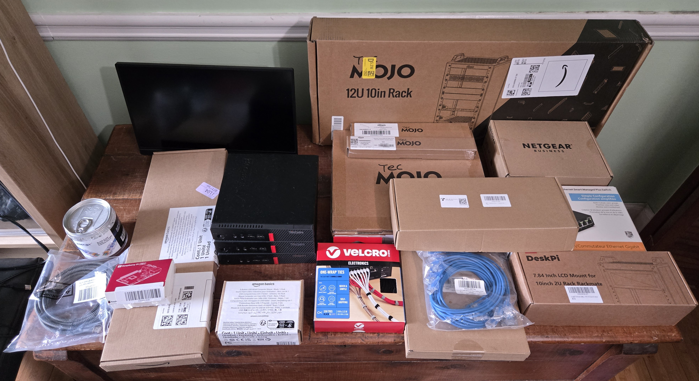
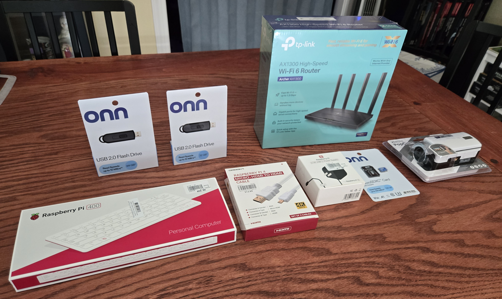
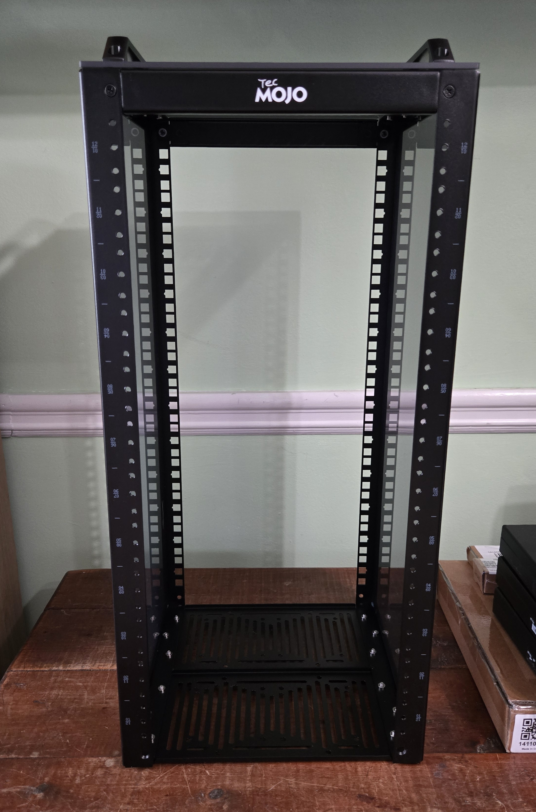
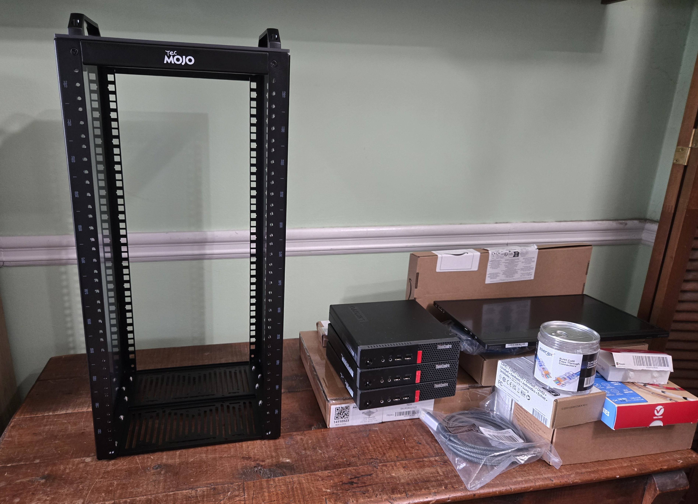
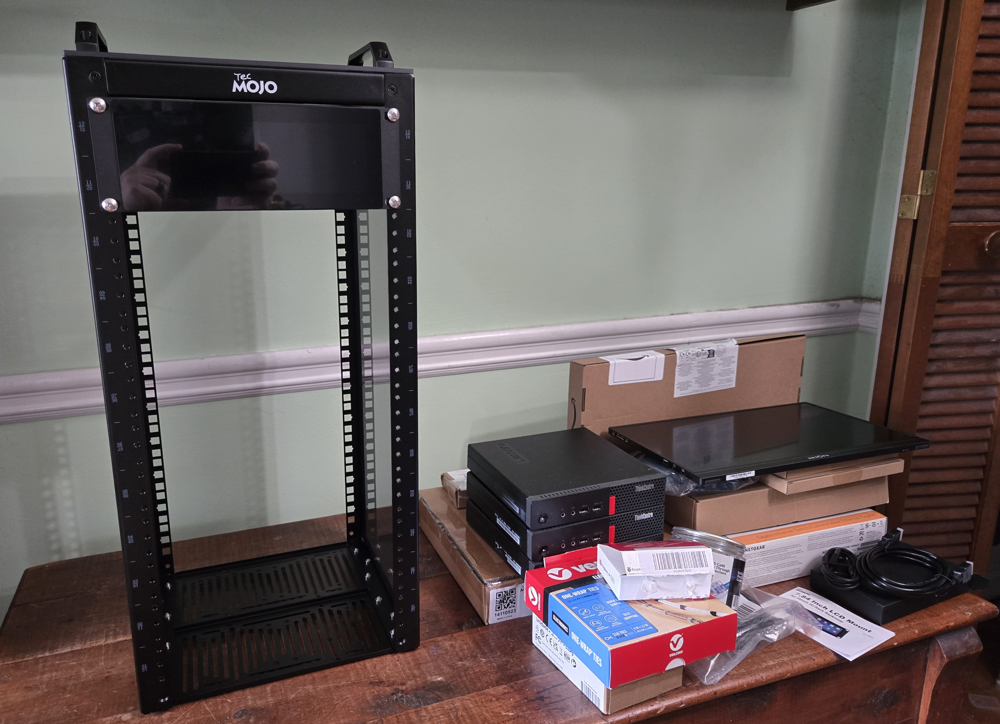
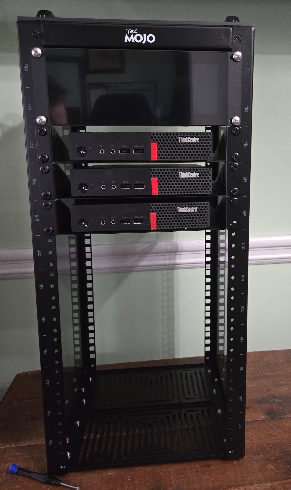
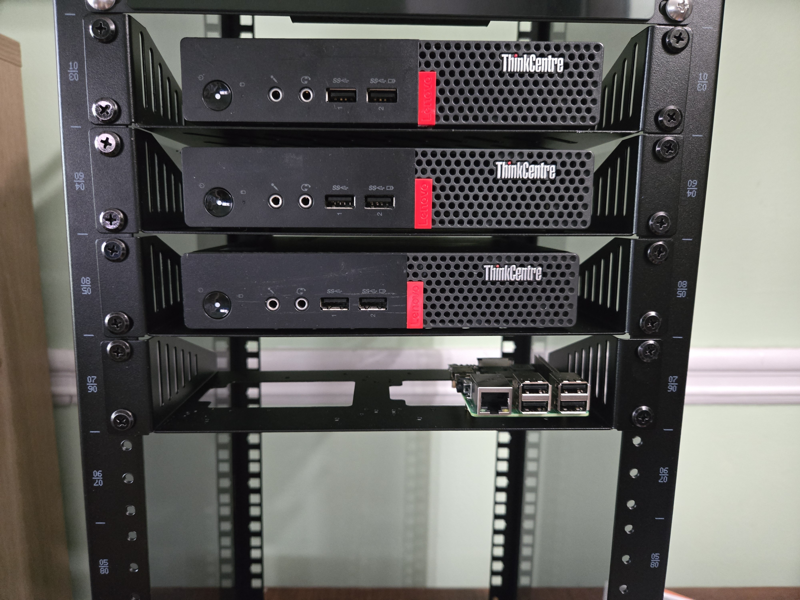
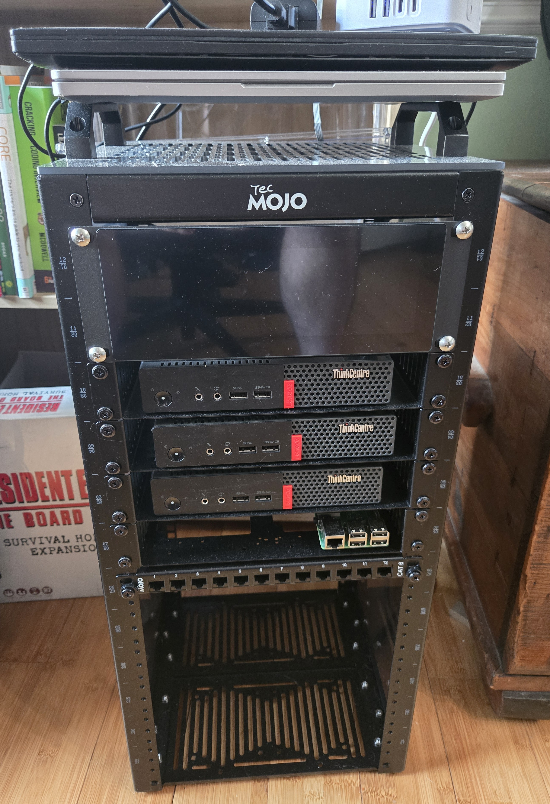
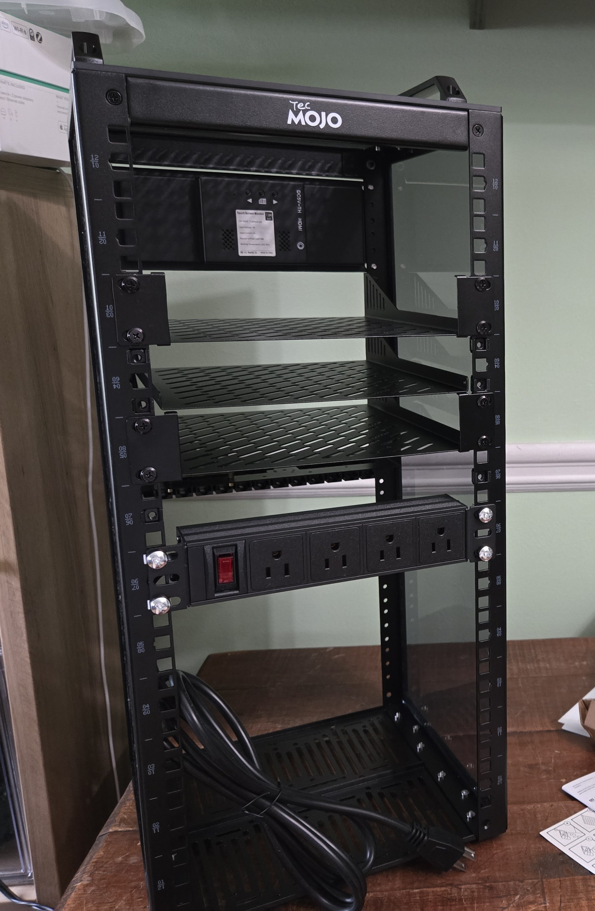

# Prelude: Building the Rack

Before the first lab day, I gathered the parts and assembled the rack that the lab runs on. This page covers how the rack came together. A full parts inventory is coming.

## Timeline

| Date | Milestone |
| --- | --- |
| 07/12/2026 | Assembled the Tecmojo 12U rack and mounted the display and tiny PCs |
| [FILL IN] | \[FILL IN: e.g. first parts ordered] |
| [FILL IN] | \[FILL IN: e.g. patch panel and switch installed] |

## Build goals

- Fit a full lab into a small footprint with a 10-inch, 12U mini rack.

- Use refurbished business mini PCs (Lenovo ThinkCentre Tiny) for low power use and low cost.

- \[FILL IN: other goals]

## Inventory

Full inventory coming soon.

| Item | Model | Qty | Cost | Where bought | Status |
| --- | --- | --- | --- | --- | --- |
| Rack | Tecmojo 12U, 10-inch | 1 | \[FILL IN] | \[FILL IN] | Installed |
| Patch panel | Tecmojo 12-port Cat6, 0.5U keystone | 1 | \[FILL IN] | \[FILL IN] | Installed |
| Power strip | NodeQore 1020J, 4 rear outlets | 1 | \[FILL IN] | \[FILL IN] | Installed |
| Display | GeeekPi 7.84" 1280x400 touch screen, 2U | 1 | \[FILL IN] | \[FILL IN] | Installed |
| Switch | NETGEAR GS308E, 8-port | 1 | \[FILL IN] | \[FILL IN] | Installed |
| Mini PC | Lenovo ThinkCentre M910q Tiny | 1 | \[FILL IN] | \[FILL IN] | Installed |
| Mini PC | Lenovo ThinkCentre M710q Tiny | 3 | \[FILL IN] | \[FILL IN] | Installed |

## Design decisions

- \[FILL IN: why a 10-inch rack instead of 19-inch]

- \[FILL IN: why the tiny PCs]

- \[FILL IN: why route everything through a patch panel]

## What I'd do differently

- [FILL IN]

## Photos

<table>

<tr>

<td> Parts delivered</td>

<td> More parts: Raspberry Pi 400 kit, router, USB drives</td>

<td> Empty rack assembled</td>

</tr>

<tr>

<td> Rack with the tiny PCs ready to go in</td>

<td> Display mounted</td>

<td> Display and tiny PCs installed</td>

</tr>

<tr>

<td> Tiny PCs and Raspberry Pi shelf</td>

<td> Patch panel added</td>

<td> Shelves and power strip</td>

</tr>

</table>

